<div align="center">

<br/>


<br/>


</div>

<br/><br/>

## `01` &nbsp;·&nbsp; about

> I write the frontend **and** the API — React on the client, Node + PostgreSQL
> on the server, Prisma and Supabase keeping the data layer clean.

```typescript
const vippin = {
  stack:    ["React", "TypeScript", "Node.js", "PostgreSQL", "Next.js"],
  current:  "Building full-stack SaaS products end-to-end",
  learning: ["AI & Agentic AI Development"],
  offline:  ["Unity 🎮", "Open source 🌱"],
  believes: "Great UIs are felt, not just seen.",
};
```

<br/>

## `02` &nbsp;·&nbsp; what i do

<table>
<tr>
<td width="33%" valign="top">

**🛰️ &nbsp;Frontend**

<sub>Interfaces that feel fast — React, Next.js, Tailwind, built with care for motion, detail and accessibility.</sub>

</td>
<td width="33%" valign="top">

**🪐 &nbsp;Backend**

<sub>Typed APIs on Node & Express, PostgreSQL through Prisma and Supabase. Clean data, boring deploys.</sub>

</td>
<td width="33%" valign="top">

**🌌 &nbsp;AI & Agents**

<sub>Currently learning to ship LLM-powered and agentic features inside real products.</sub>

</td>
</tr>
</table>

<br/><br/>

## `03` &nbsp;·&nbsp; stack

<table>
<tr><td width="160"><sub><b>LANGUAGES</b></sub></td><td></td></tr>
<tr><td><sub><b>FRONTEND</b></sub></td><td></td></tr>
<tr><td><sub><b>BACKEND & DATA</b></sub></td><td></td></tr>
<tr><td><sub><b>TOOLS</b></sub></td><td></td></tr>
</table>

<br/><br/>

## `04` &nbsp;·&nbsp; telemetry

<div align="center">


<br/>


<br/><br/>


<!-- Snake: images come from the `output` branch, created by the "Generate contribution snake" action. -->
<br/><br/>
<picture>
  <source media="(prefers-color-scheme: dark)" srcset="https://raw.githubusercontent.com/Massvippin01/Massvippin01/output/snake-dark.svg" />
  
</picture>

</div>

<br/><br/>

## `05` &nbsp;·&nbsp; signal

<a href="https://github.com/Massvippin01"></a>
&nbsp;
<a href="https://instagram.com/mass_vippin"></a>

<br/><br/>


